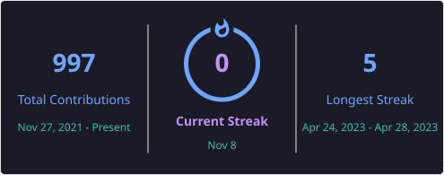

# 💫 About Me:
Who knew what time it was when the first clock was made? 👀

# 💻 Tech Stack:

## ☁️ Cloud & DevOps

     

## 🐧 Linux & Scripting

    

## 🧑‍💻 Development

            

# 📊 GitHub Stats:
 
 

## 🏆 GitHub Trophies

### Snake
<picture>
  <source media="(prefers-color-scheme: dark)" srcset="https://raw.githubusercontent.com/platane/platane/output/github-contribution-grid-snake-dark.svg">
  <source media="(prefers-color-scheme: light)" srcset="https://raw.githubusercontent.com/platane/platane/output/github-contribution-grid-snake.svg">
  
</picture>

### ✍️ Random Dev Quote

---

